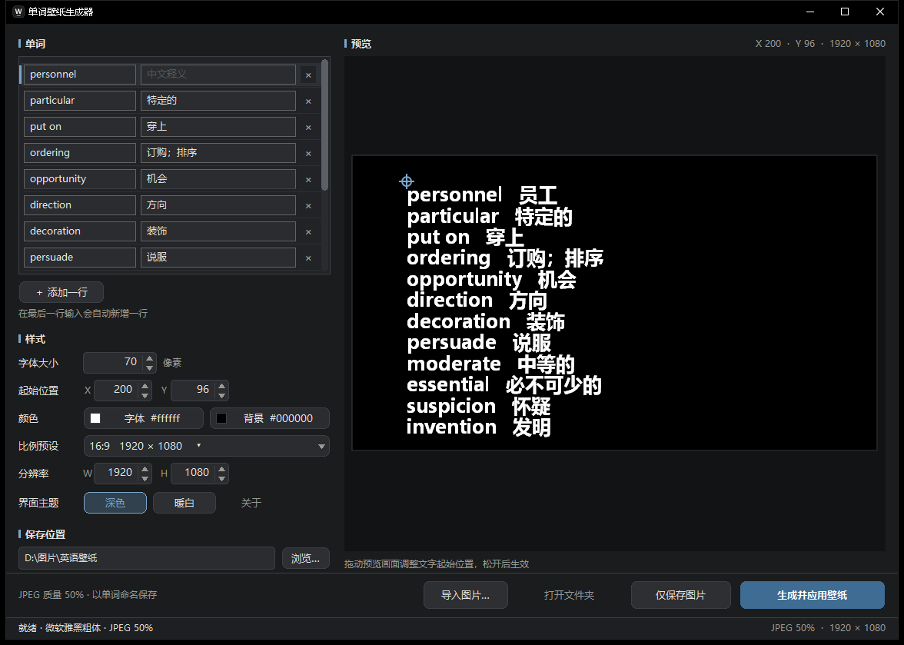
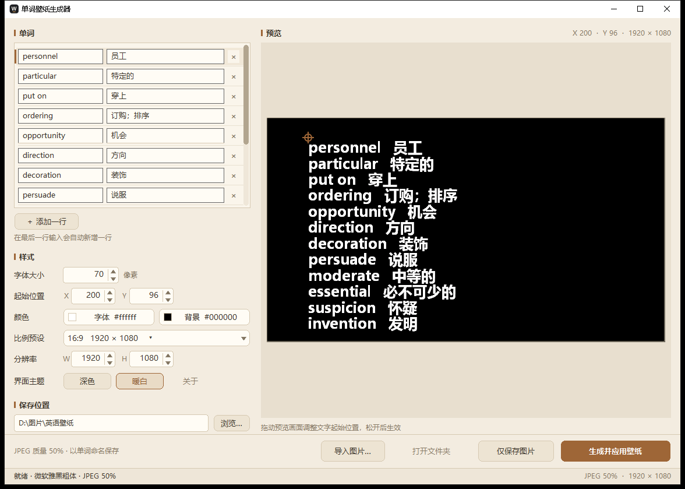
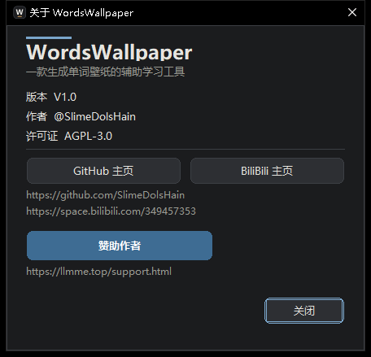

# WordsWallpaper · 单词壁纸生成器 V1.0

用 C++ / Win32 + GDI/GDI+ 重写的“单词壁纸生成器”。输入单词和中文意思，生成一张黑底白字的 JPEG 壁纸，并可直接设为桌面壁纸。

- 程序：单文件 `WordsWallpaper-x64.exe` / `WordsWallpaper-x86.exe`（静态链接，不依赖 Qt / Python / 额外运行库）
- 系统：Windows 7 SP1 / 8 / 8.1 / 10 / 11，**32 位与 64 位**
- 字体：微软雅黑粗体 `C:\Windows\Fonts\msyhbd.ttc`（系统自带，不随程序打包）
- 图片：JPEG，质量固定 50%（与原版一致）
- 许可证：AGPL-3.0
- 版本：V1.0







## 下载

到 GitHub 的 **Releases** 页面下载对应版本：

| 文件 | 适用系统 |
| --- | --- |
| `WordsWallpaper-x64.exe` | 64 位 Windows 7 / 8 / 8.1 / 10 / 11 |
| `WordsWallpaper-x86.exe` | 32 位 Windows 7 / 8 / 8.1 / 10 / 11；也可在 64 位系统上运行 |
| `WordsWallpaper.exe` | 与 x64 版相同的便捷副本 |

程序是绿色单文件，不需要安装。首次生成图片时会要求选择保存文件夹。

## 功能

原版功能全部保留：

- 添加 / 删除单词条目，每行“外文单词 + 中文释义”
- 设置文字起始位置、字体大小、文字颜色、背景颜色
- 自定义输出分辨率
- 图片预览
- 以单词为文件名保存 JPEG
- 生成后调用系统 API 设置为桌面壁纸

本次新增 / 改进：

1. **窗口可自由缩放**：所有控件随窗口大小重新布局，支持最小尺寸和最大化，适配高 DPI。
2. **在所选行下方插入**：点“添加一行”时，新行插入到当前选中的行下面，而不是永远加在末尾；当前行左侧有强调色竖条。在最后一行输入内容时仍会自动追加空行。
3. **常见比例预设**：16:9、16:10、21:9、4:3、3:2、1:1 等常用分辨率，点开“比例预设”按钮选择。
4. **实时预览**：修改文字、字号、颜色、分辨率、位置时预览自动刷新（防抖 ≈ 45 ms）。
5. **预览画面直接拖动文字位置**：预览中显示十字准星和参考虚线，按住拖动时文字实时跟随，**松开鼠标后才写入位置数值**；按 Esc 可取消本次拖动。
6. **深色 / 暖白护眼双主题**：深色为默认，暖白为米黄色纸张观感；主题会保存。
7. **首次使用提示保存位置**：配置文件不存在或保存地址为空时，第一次生成 / 应用会弹出文件夹选择框（标题为“首次使用：请选择壁纸图片的保存位置”），取消则不会生成图片。
8. **图片即工程文件**：保存 JPEG 时把单词、释义、字体大小、位置、分辨率、颜色等写入文件备注；之后点“导入图片…”即可恢复，详见下文。
9. **关于窗口**：界面主题右侧新增“关于”按钮，显示版本、作者、GitHub、BiliBili、许可证和赞助入口。
10. **启动不再白屏闪烁**：窗口先在屏幕外完成布局和主题绘制，再移动到屏幕内；Windows 10/11 深色主题下标题栏也会同步变暗。
11. **Windows 7 / 8.1 与 32 位兼容**：按 Windows 7 API 级别编译，PE 子系统版本 6.1；同时提供 x64 与 x86 两个构建。
12. **其他细节**：滚轮滚动单词列表、每行右侧 `×` 删除、Tab 顺序、Enter 跳到下一行、Ctrl+S / Ctrl+O / Ctrl+Enter 快捷键、状态栏显示保存结果与文件大小、错误提示。

## 使用

1. 双击对应版本的 exe。
2. 在“单词”区域输入外文单词，Tab 或 Enter 切到中文释义；在最后一行输入会自动增加下一行。
3. 想在某一行后面插入新行：先点一下那一行的输入框，再点“添加一行”。
4. 调整“样式”：字体大小（像素）、起始位置 X/Y、文字/背景颜色、比例预设或自定义分辨率。
5. 在右侧预览中拖动可以调整文字起始位置，松开鼠标生效。
6. 选择“生成并应用壁纸”，或“仅保存图片”。
7. 想继续编辑以前生成的图片：点“导入图片…”（Ctrl+O），选择那张 JPEG，单词和样式会自动恢复。
8. 首次生成前会要求选择保存文件夹；生成的文件名为第一列单词用空格连接，扩展名 `.jpg`。

### 快捷键

| 按键 | 作用 |
| --- | --- |
| Tab / Shift+Tab | 在单词、释义、样式控件之间切换 |
| Enter（单词格） | 跳到同一行的中文释义 |
| Enter（释义格） | 跳到下一行的单词；已是最后一行则自动新增一行 |
| Ctrl+S | 仅保存图片 |
| Ctrl+O | 导入带工程备注的图片 |
| Ctrl+Enter | 生成并应用壁纸 |
| Esc（拖动中） | 取消拖动 |
| Esc（关于窗口） | 关闭关于窗口 |
| 鼠标滚轮 | 单词列表滚动 |

## 关于

界面“样式 → 界面主题”右侧的“关于”按钮会打开关于窗口，内容为：

- WordsWallpaper，一款生成单词壁纸的辅助学习工具
- 版本 V1.0
- 作者 @SlimeDolsHain
- GitHub：`https://github.com/SlimeDolsHain`
- BiliBili：`https://space.bilibili.com/349457353`
- 许可证 AGPL-3.0
- 赞助作者：`https://llmme.top/support.html`

GitHub / BiliBili / 赞助都是按钮，点击后用默认浏览器打开。

## 工程备注与导入

每次保存（“仅保存图片”或“生成并应用壁纸”）时，程序都会把当前工程写进 JPEG 文件：

- **EXIF UserComment**：Windows 资源管理器的文件属性“备注”会显示这段文字（已验证 Windows 10 可正确显示中文）。
- **JPEG COM 备注段**：程序自带的“导入图片…”从这里读取，快捷键 Ctrl+O。
- 两种备注使用相同的内容，包含：单词列表、中文释义、字体大小、起始位置、分辨率、文字/背景颜色、界面主题、JPEG 质量等。
- 备注大约增加 1 KB 文件大小，不影响图片显示，也不影响其他看图软件打开。
- 通过命令行或“打开方式”直接导入：

```powershell
.\WordsWallpaper.exe --import "D:\图片\英语壁纸\apple banana.jpg"
```

也可以把带备注的 JPEG 直接拖到 `WordsWallpaper.exe` 上。

备注内容示例（也是文件“备注”里看到的内容）：

```text
WordsWallpaper-Project-1
app=WordsWallpaper
format=2
app_version=1.0
font_size=70
pos_x=200
pos_y=96
res_w=1920
res_h=1080
font_color=#ffffff
bg_color=#000000
theme=dark
quality=50
count=2
word_0=apple
mean_0=苹果
word_1=banana
mean_1=香蕉
```

导入会恢复 **单词、释义、字体大小、起始位置、分辨率、文字/背景颜色**；不会改变当前的保存文件夹和界面主题（这两项属于本机环境/个人偏好）。如果图片是用其他软件另存过、备注被清除，导入会提示“没有工程备注”。

## 关于字体和压缩

- 程序启动时会尝试从 `%WINDIR%\Fonts\msyhbd.ttc` 以私有字体方式加载 Microsoft YaHei Bold / 微软雅黑粗体；找不到时回退到系统“微软雅黑”，再找不到则回退到 Segoe UI。字体文件不打包，避免 16 MB 的体积。
- 生成图片使用 GDI+ JPEG 编码器，质量参数固定为 **50**，与 Python 版 `save(..., quality=50)` 一致。1920×1080、12 行文字的图片通常约 100 KB。
- 预览图只保存在内存中，不会像原版那样产生 `preview.jpg` 临时文件。

## 配置

首次运行后会在 exe 同目录创建 `config.ini`（UTF-8），包含：

```ini
[color]
font_color=#ffffff
bg_color=#000000

[location]
value_w=200
value_h=350

[font]
size=100

[address]
addr=D:\图片\英语壁纸

[resolution]
res_w=1920
res_h=1080

[ui]
theme=dark

[window]
width=1160
height=800
maximized=0
```

- `addr` 为空时会触发首次保存位置选择。
- 若程序放在不可写目录（如 `Program Files`），配置文件写入会失败并在状态栏提示；请把程序放在可写目录使用（绿色便携方式）。
- 单词列表本身不单独持久化（和 Python 版一样）；但每次保存都会把它写进 JPEG 备注，导入图片即可恢复。

## 构建

需要 MinGW-w64（g++ 与 windres 在同一目录），支持 C++17。构建脚本会自动查找 PATH、CLion 自带 MinGW 和常见安装目录，也可以用 `-Compiler` 指定。

### 64 位

```powershell
cd rewrite
.\build.ps1 -Arch x64
```

输出 `WordsWallpaper-x64.exe`，并复制一份为 `WordsWallpaper.exe`。

### 32 位

需要 i686 MinGW-w64 工具链（例如 MSYS2 的 `mingw32` 环境，或 i686 版 MinGW-w64）：

```powershell
.\build.ps1 -Arch x86 -Compiler "C:\msys64\mingw32\bin\i686-w64-mingw32-g++.exe"
```

输出 `WordsWallpaper-x86.exe`。

### 说明

- 两个架构都按 **Windows 7 API 级别** 编译（`_WIN32_WINNT=0x0601`），PE 可选头的主/子系统版本为 6.1；链接后只导入 Windows 7 已存在的系统 API。
- 使用 `-static -static-libgcc -static-libstdc++` 静态链接，生成单文件。
- 构建脚本会把 windres 的 `gcc.exe` 加入 PATH，并传 `-xc -DRC_INVOKED` 预处理参数，兼容编译器路径中带空格的情况。
- 其他选项：

```powershell
.\build.ps1 -Arch x64 -Test     # 控制台渲染测试程序
.\build.ps1 -Arch x64 -Clean    # 清理该架构的 build 目录后重新编译
.\build.ps1 -Arch x64 -Config Debug
```

## Windows 兼容性说明

- 目标系统：Windows 7 SP1、Windows 8、Windows 8.1、Windows 10、Windows 11；32 位和 64 位。
- 32 位程序可以在 64 位 Windows 上直接运行（WOW64），64 位程序不能在 32 位 Windows 上运行。
- 程序只使用 Windows 7 已有的 Win32 / GDI / GDI+ / Common Controls 6 / Shell API；Windows 10 才有的 DPI 和深色标题栏 API 通过 `GetProcAddress` 动态加载，找不到时自动回退。
- Windows 7 / 8.1 上标题栏使用系统颜色（深色标题栏是 Windows 10 1903+ 才支持）；窗口内容仍是深色/暖白主题。
- Windows 7 使用系统 DPI 感知；Windows 8.1 使用 per-monitor DPI；Windows 10/11 优先 PerMonitorV2。
- 本机为 Windows 10，x64 与 x86 均已在 Windows 10 上运行验证（x86 通过 WOW64）；尚未在真实 Windows 7 / 8.1 机器上做人工测试。如在这些系统遇到问题，请附上系统版本和截图反馈。

## 仓库与发布

源码仓库根目录只放源码、构建脚本、文档和许可证；编译好的 exe 放在 GitHub **Releases** 里，不打进源码历史：

- 仓库：main.cpp、build.ps1、resource.rc、app.manifest、icon.ico、README.md、LICENSE、.gitignore、docs/
- Release 附件：WordsWallpaper-x64.exe、WordsWallpaper-x86.exe
- 不要上传：config.ini、build/、_test/、*.jpg、.tools/、IDE 配置

## 存储占用

| 项目 | 大小 |
| --- | --- |
| `WordsWallpaper-x64.exe` | ≈ 373 KB |
| `WordsWallpaper-x86.exe` | ≈ 358 KB |
| 源码、脚本、图标、文档、许可证 | 约 347 KB |
| 运行时 `config.ini` | 约 0.3 KB |
| 生成的 JPEG（1080p，12 行） | 约 50–115 KB / 张（含约 1 KB 备注） |

软件本体远小于 10 MB，并且 exe 不依赖 Qt / Python / 额外 DLL。

## 文件结构（本地构建目录；源码仓库不提交 exe）

```text
rewrite/
├─ WordsWallpaper-x64.exe   64 位编译产物
├─ WordsWallpaper-x86.exe   32 位编译产物
├─ WordsWallpaper.exe       x64 便捷副本
├─ main.cpp                 全部源码（Win32 + GDI/GDI+，单文件实现）
├─ build.ps1                构建脚本（-Arch x64/x86）
├─ resource.rc              图标 + 清单 + 版本信息
├─ app.manifest             DPI 感知 / Common Controls 6 / 长路径
├─ icon.ico                 应用图标
├─ LICENSE                  AGPL-3.0 许可证全文
├─ .gitignore
├─ docs/
│  ├─ dark.png
│  ├─ light.png
│  └─ about.png
└─ README.md
```

## 已知限制

- 比例预设使用系统原生的弹出菜单；深色主题下菜单仍是系统浅色样式（界面本身不受影响）。
- 分辨率上限为 8192×8192、总像素 4000 万；超过会提示并拒绝保存，避免内存占用过大。
- 预览按实际显示尺寸重新缩放渲染（不是缩小整张 4K 位图），因此预览里的字形与最终大图在像素级抗锯齿上可能略有差异，但字号、行距、位置比例一致。
- 保存位置对话框、颜色选择器、导入文件对话框使用系统原生对话框。
- 单词列表不单独跨会话保存；请通过保存图片时的工程备注恢复。
- 工程备注可见于 Windows“备注”字段，但导入读取的是 JPEG COM 段；若用其他工具清除了 JPEG 备注，导入会失败。界面主题和保存文件夹不会随图片恢复。
- Windows 7 / 8.1 未在真实机器上人工测试；如遇问题请反馈。
- 程序未做代码签名，Windows SmartScreen 可能提示；可选择“更多信息 → 仍要运行”。
- 32 位构建需要单独安装 i686 MinGW-w64 工具链。

## 作者与许可证

- 作者：@SlimeDolsHain
- GitHub：https://github.com/SlimeDolsHain
- BiliBili：https://space.bilibili.com/349457353
- 赞助：https://llmme.top/support.html
- 许可证：**AGPL-3.0**，完整文本见 [LICENSE](LICENSE)。

本目录为 C++ 重写版本，保留原 Python 版的字体、JPEG 质量、命名方式等核心行为。原 Python 版作者：bilibili@史莱姆-多尔斯海恩 / GitHub@SlimeDolsHain。
